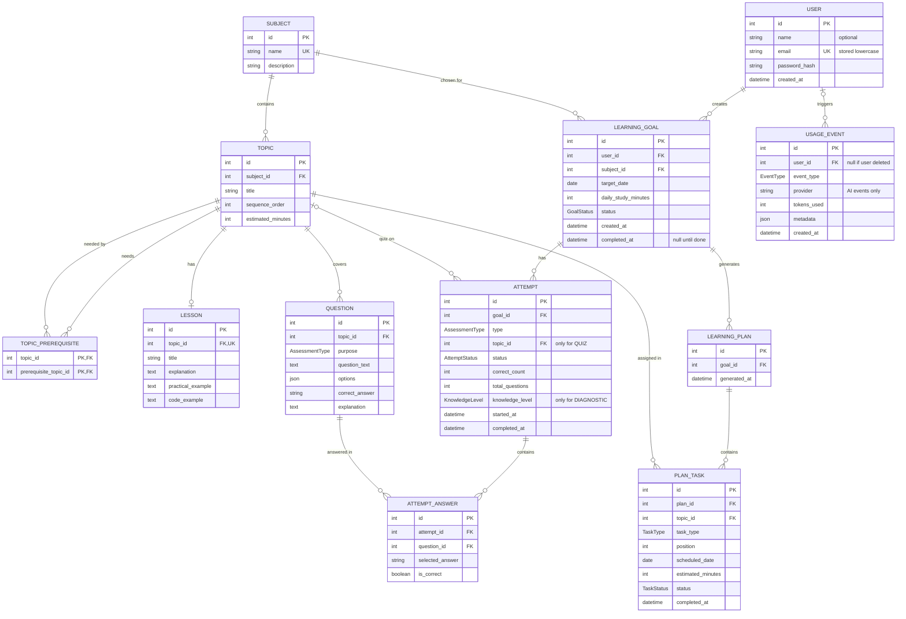

# StudyPilot ERD

## Enums

- AssessmentType: DIAGNOSTIC, QUIZ
- GoalStatus: ACTIVE, COMPLETED
- AttemptStatus: IN_PROGRESS, COMPLETED
- KnowledgeLevel: names and thresholds are defined in the Learning and AI Logic document
- TaskType: LEARN, QUIZ
- TaskStatus: PENDING, COMPLETED (a missed task is a PENDING task with a past date)
- EventType: SIGN_UP, GOAL_CREATED, TASK_COMPLETED, QUIZ_COMPLETED, AI_REQUEST, AI_FAILURE

## Rules

- One active goal per user: a partial unique index on learning goals (user_id) where status is ACTIVE. Prisma cannot express this, so it is added as raw SQL in a migration.
- Deleting a user deletes their goals, plans, tasks, attempts and answers. usage_events.user_id becomes null so anonymous metrics remain.
- Content tables (subject, topic, lesson, question) are never deleted by user actions. A topic cannot be deleted while tasks or attempts reference it.
- Unique constraints: users.email, subjects.name, lessons.topic_id, (subject_id, sequence_order) on topics, (plan_id, topic_id, task_type) on plan tasks, (attempt_id, question_id) on attempt answers.
- Indexes: usage_events (user_id, event_type, created_at) for the daily AI limit, attempts (goal_id, topic_id), plan_tasks (plan_id, scheduled_date).
- is_correct is saved when an answer is scored, so editing a question later never changes past results.
- A QUIZ attempt must have a topic_id. A DIAGNOSTIC attempt has no topic_id.
- Email is stored in lowercase.
- The plan is generated from the latest COMPLETED diagnostic attempt for the goal.
- At most one IN_PROGRESS attempt per goal, type and topic: a partial unique index added as raw SQL in a migration. Diagnostic attempts have no topic_id, so the index must treat that null explicitly.